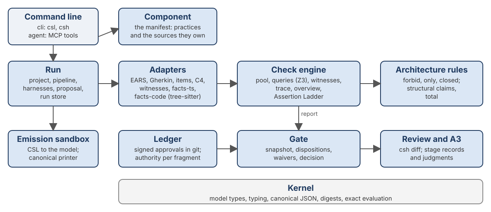
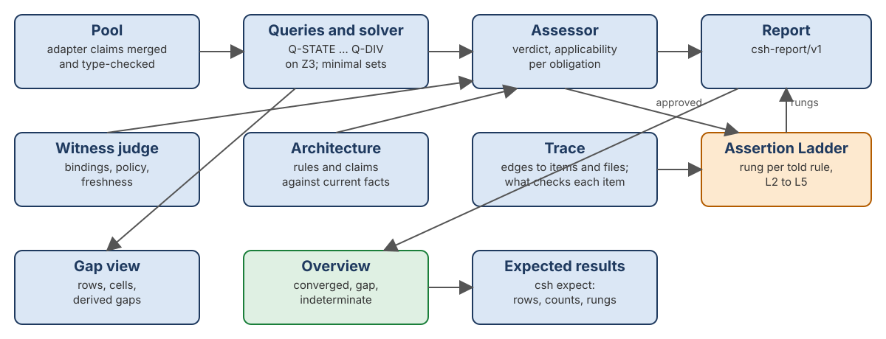

<!-- _class: lead -->
<!-- _paginate: false -->

# CSH
## The Composable Specification Harness

A static analysis tool for what a codebase *says* about itself:
what converges, what is a gap, and what cannot be decided.

<span class="small">github.com/lgriffin/CSH · with the Assertion Ladder, stages 45 to 50</span>

---

## The problem

Software is changed faster than ever, increasingly by AI agents.

- Requirements, scenarios, unit tests, design notes, C4 diagrams and agent instructions each protect something.
- Each is judged **alone**, and each can be green while together they disagree.
- "The tests pass" is routinely taken as "the change is correct".

> CSH exists so that software cannot be declared correct on evidence that does not support the claim.

---

## What CSH is

- **A reader, not a replacement.** It reads what your practices already produce. It runs nothing in your subject and changes nothing.
- **A reporter of disagreement.** Two sources that cannot both hold are a finding, with the minimal set that collides.
- **A record of authority.** Which statements a person approved, signed in git.
- **A gate.** An approved rule a change breaks is blocked, even when the tests stay green.

The output is a view for informed decisions, **not a certificate**. What CSH cannot establish, it reports as unknown.

---

## The outcome: three places a result can land

| Outcome | Means | Example |
| --- | --- | --- |
| <span class="converged">Converged</span> | The claim and the code agree, with evidence | A satisfied rule; a requirement whose tests pass |
| <span class="gap">Gap</span> | An addressable suggestion: where it is and what would close it | Prose the code refutes; a requirement nothing verifies |
| <span class="indeterminate">Indeterminate</span> | What CSH could not decide, and the input that would decide it | A solver timeout; an unapproved binding |

Every rule, claim and trace lands in exactly one. Nothing is a score.

---

## How it works: one run

1. **Sources.** The manifest (`csh/component.json`) names practices and the files each owns.
2. **Adapters.** Each source goes through an isolated adapter: claims, witnesses, items and edges, the C4 diagram, code facts.
3. **The specification.** Rules written in CSL, a small TypeScript DSL, cite the sentences they formalise.
4. **The check.** A solver (Z3) looks for conflicts; witnesses are judged; architecture rules and structural claims are compared with facts; edges are traced.
5. **The gate.** Authority from the signed ledger decides allow, review or block.
6. **The record.** A stored run, keyed by the snapshot digest, that later commands read.

---

## The sources it reads

| Practice | Read as |
| --- | --- |
| EARS requirements, requirement tables | sentences and identified items |
| Gherkin scenarios | examples, through a step table |
| Unit tests | witnesses from a probe; citations in titles |
| C4 container diagram (Mermaid) | containers and relations, a checked source |
| Code: TypeScript, Python, Java, Go, Rust | facts: modules, imports, declarations, closed types |
| Documents, instruction files, issues, traces | items and edges: what they name must resolve |
| Git history | when a line was written, what changed since |

---

## Two findings

**Joint conflicts.** A holds, B holds, and they cannot both hold in a shared context:

```
SAT(C ∧ A)    SAT(C ∧ B)    UNSAT(C ∧ A ∧ B)
```

CSH names a minimal conflicting set and offers three readings: a member is wrong, a context is missing, or the intent is undecided. It chooses none.

**Gaps.** An approved rule with no boundary example; a passing test with no rule behind it; a sentence nothing cites; a document line older than the file it names.

---

## Four axes, never merged

| Axis | Values | Decided by |
| --- | --- | --- |
| Authority | approved, candidate, retired | signed ledger entries only |
| Verdict | conflicting, violated, satisfied, unknown | the check |
| Applicability | current, stale, inapplicable, unavailable | the evidence's digests |
| Disposition | allow, review, block, waived | the gate only |

A passing test is an execution fact, never a verdict. A waived violation is still a violation.

---

## Authority

- Approval is a line in `csh/ledger.ndjson`, committed alone and signed by a person key in `csh/maintainers.json`.
- Agents can do everything a contributor does, but **an agent's key cannot approve**.
- Changing what a fragment means changes its digest and returns it to candidate.
- `csh status` says whether a repository is protected or only able to be; `csh queue` lists what awaits the owner.

---

## Design: containers



<span class="small">A simplified view of the C4 container diagram, docs/architecture/containers.mmd: fourteen runtime containers, every package named, and the diagram is itself a checked source.</span>

---

## Design principles

- **Static and sandboxed.** Adapters run in permission-restricted subprocesses, seeing only bytes. Specifications emit in a locked-down sandbox.
- **Unknown over a guess.** A missing binding, policy or reader gives `unknown` with a reason, never `satisfied`.
- **Fixtures first.** 106 golden fixtures, written blind from the documents before the code, gate every stage.
- **One standard per language.** TypeScript, Python, Java, Go and Rust meet the same testing and requirements bar.
- **Decisions are recorded.** Every choice made during the build is in `ASSUMPTIONS.md`; every open one in `QUESTIONS.md`.

---

## Design: the check engine



<span class="small">Simplified from docs/architecture/components-check.mmd. The ladder reads the same evidence as the outcome and moves none of it.</span>

---

## Cross-language facts

| Language | Read by | Imports | Closed types | Complete mapping |
| --- | --- | --- | --- | --- |
| TypeScript | TS compiler API | yes | literal unions, `enum` | `Record<K, V>` |
| Java | tree-sitter (WASM) | yes | `enum`, `sealed` | `switch` with no `default` |
| Rust | tree-sitter (WASM) | yes | `enum` | `match` with no catch-all |
| Python | tree-sitter (WASM) | yes | none | unknown: `no-compiler` |
| Go | tree-sitter (WASM) | yes | none | unknown: `no-closed-types` |

No toolchain of the subject's language is installed or run. Facts carry the commit they were read at, and go stale when the code moves.

---

## The Assertion Ladder

How strongly a repository asserts each rule (Griffin et al., *The Assertion Ladder*, JOT, submitted 2026).

| Rung | The rule is | CSH sees it when |
| --- | --- | --- |
| L0 Implied | in someone's head | (not in the repository) |
| L1 Shown | embodied by a worked slice | (a shape, not one rule) |
| L2 Told | stated in prose | a source states it, nothing checks it |
| L3 Checked | enforced by a check | a test or scenario cites it |
| L4 Explained | enforced by a check that names rule, offender, fix | an approved CSH obligation cites it |
| L5 Prevented | impossible to write wrongly | a holding `total` claim cites it |

---

## Two axes, one identity

- **The outcome** stays what CSH is for: converged, gap or indeterminate. The ladder adds no fourth outcome and moves no result.
- **The rung** is a second axis on every told rule: the highest its evidence establishes, a floor and never a guess.
- A rung counts only what stops a wrong change **in the repository itself**: its tests, its compiler, its approved obligations. CSH's own candidate reading never raises one.

A rule can be well asserted and wrong (L3 with a failing test: a gap), or weakly asserted and right (L2, nothing contradicts it).

---

## Prevention, read statically

```ts
// typescript/src/api/error-handler.ts
const STATUS_BY_CODE: Record<ErrorCode, number> = { ... };
```

```ts
// the profile's claim, citing R-ERR-1
i.claim("ErrorStatusIsTotal",
  total("typescript/src/api/error-handler.ts", "STATUS_BY_CODE", "ErrorCode"),
  { cites: [{ source: Requirements, id: "R-ERR-1" }] });
```

Adding a member to `ErrorCode` without a status does not compile, so `R-ERR-1` is **L5**. A `default` arm in Java or a `_` arm in Rust refutes the same claim. Nothing is compiled to know it.

---

## Outputs

- **`csh run` / `csh check`:** the report, `csh-report/v1`, and its text rendering.
- **`csh overview`:** every result as converged, gap or indeterminate, with what would move it; text and an HTML sheet; now with the ladder line.
- **`csh ladder`:** every told rule, weakest first, with why it sits on its rung.
- **`csh expect`:** a profile's committed expectations, rungs included, as mismatches.
- **`csh diff`:** what a change did, from two stored runs, with what costs a reviewer a decision first.
- **The A3:** gaps read as one problem, with candidate causes and countermeasures, across stages.

---

## What the overview says

```
CSH overview: 0 gaps, 1 indeterminate, 7 converged
Assertion Ladder: 0 told (L2), 10 checked (L3), 0 explained (L4), 0 prevented (L5)

== Indeterminate: what could not be decided (1)

  specification
       1  unknown-obligation: Supply the evidence its reasons name,
          or approve what it waits on
```

<span class="small">taskboard-python at the paper's pinned commit: the `total` claim is unknown, because no compiler checks a Python mapping.</span>

---

## Results on real code

| Subject | Language | Converged | Gaps | Indeterminate | Ladder |
| --- | --- | --- | --- | --- | --- |
| ESI.ts | TypeScript | 43 | 114 | 8 | |
| taskboard | TypeScript | 8 | 0 | 0 | 9 × L3, R-ERR-1 L5 |
| taskboard | Java | 8 | 0 | 0 | 9 × L3, R-ERR-1 L5 |
| taskboard | Python | 7 | 0 | 1 | 10 × L3 |

Plus pinned public profiles in Python, Java, Go and Rust. CI runs every profile and fails on any expectation that changes.

---

## The lockout example

Sign-in lockout described three ways: EARS requirements, BDD scenarios, unit tests. Each signed off alone. Read together they disagree on **nine decision points**:

- an off-by-one between the tests and the requirements
- two EARS sentences that cannot both hold
- a unit the scenarios state in minutes
- cases only one practice can express

The walkthrough fixes them, approves the model, then commits a regression that keeps the tests green. **The enforcing gate blocks it.**

---

## Adopting it

| Step | You add | You get back |
| --- | --- | --- |
| 1 | `csh init` (or `--subject` to propose a profile) | every requirement as an item; uncited and unverified gaps |
| 2 | a vocabulary and a probe | passing tests as examples |
| 3 | one rule citing one sentence | the first place a test can disagree with prose |
| 4 | a second practice | conflicts and divergences across practices |
| 5 | a model | rules the solver checks |
| 6 | authority and the enforcing gate | a green-test regression blocked |
| 7 | an A3 | the sheet |

Stop where the value stops. Each step stands alone.

---

<!-- _class: lead -->

## In one line

**CSH reads what a codebase already asserts, tells you where it converges, where it has gaps, and what it cannot decide, and now how strongly each rule is held.**

<span class="small">Spec: docs/spec · Guides: docs/guides · Ladder: docs/spec/14-assertion-ladder.md</span>
