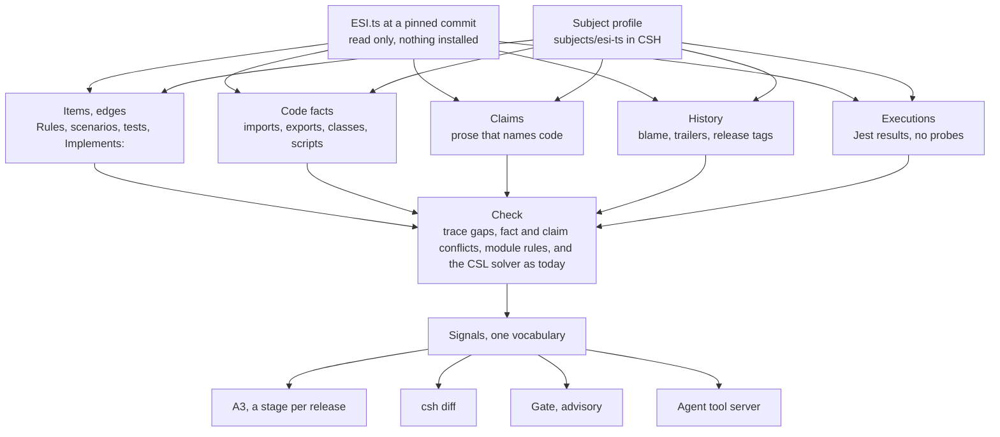

# CSH: Ingesting a Codebase (ESI.ts)

Oct 11, 2026 · @Leigh · Design, read-only copy

> A read-only copy of the design document "CSH: Ingesting a Codebase (ESI.ts)", taken on 11 October 2026. Claude wrote it at the owner's request ("I want to take my ESI.ts project and run it through CSH … it will be a significant refactoring of CSH"). Like tabs 0 to 10, it is not edited in the repository. Where it and tabs 0 to 10 disagree, it governs for the amendments in its last section and nowhere else. Its one figure is redrawn here as a Mermaid diagram.

## Summary

CSH can say nothing about ESI.ts today without a hand-written state-machine model. Yet ESI.ts already holds about 700 requirement sentences, 790 scenarios, 1,230 test files and 1,469 commits that CSH could read. This plan turns CSH from a harness for specifications written in its own language into a harness that ingests a real git repository. It finds what the repository's practices say, and reports where they disagree with each other and with the code.

The refactoring adds four layers beneath the existing CSL model rather than replacing it:

1. **Subject profiles.** CSH configuration lives outside the subject repository, pinned to a subject commit, so ESI.ts stays untouched.
2. **The item graph.** Every specification-bearing artefact becomes an identified item: a charter requirement, a Gherkin Rule, a scenario, a test, a guide section, an issue or a commit. Items are joined by the trace edges the artefacts already state (`Implements:`, `Verified by:`, `Refs:`, tags).
3. **Code facts and structural claims.** A syntax-only TypeScript scan records modules, imports, exports, classes and scripts at any commit, with nothing installed. Prose that names code becomes claims checked against those facts.
4. **History.** Git shows which prose is older than the code it describes, and which commits change behaviour without a test or a reference. It also shows how every signal moved across ESI.ts releases.

The CSL model, the solver, authority, the gate, the A3 and `csh diff` all stay. They gain a much wider floor: the first rung of the ladder becomes "point CSH at a repository" rather than "write a model". There are eight stages, 21 to 28. Each lands as one PR on CSH, with ESI.ts as the subject throughout.

## What ESI.ts holds

ESI.ts (v11.3.0, commit `2a2da8a`) is a TypeScript client for the EVE Online ESI API: 288 source files, about 53,600 lines and 39 domain clients. Nearly every practice CSH was built to compare is present, and most already state their own trace links.

| Practice | Where | Size | Trace it already states |
| --- | --- | --- | --- |
| Charter requirements (EARS) | `guides/CHARTER.md` | 66 requirements, with IDs ARCH, DES, TEST, GATE, SEC, DOC, REL and PROC; status Enforced 50, Practised 6, Partial 9, Gap 1; a 33-row gap register | `Verified by:` naming scripts and tests |
| Gherkin Rules (EARS) | `tests/bdd/features/**` | 77 features, 619 Rules (31 `shall not`), 792 scenarios, 10 outlines | Rule above its scenarios; `@sec-P1` to `@sec-P9` tags; no IDs |
| Step library | `tests/bdd/steps/**` | 695 one-step files, 29 legacy step files | Cucumber expressions |
| Unit and other tests | `tests/tdd`, `fuzz`, `contract`, `typetests`, `faults` | 230 unit, 15 property, 7 contract and 12 type-test files; about 10,000 tests on Jest 30 | 17 files cite charter IDs |
| Guides | `guides/*.md` | 25 guides, about 10,000 lines, 20 Mermaid diagrams | `**Implements:** DES-01 · DES-02` on each guide |
| Security model | `guides/security-model.yaml` | Properties P1 to P12 | `tests:`, `charter:`, `rule: none` with a reason |
| Layering rules | `config/eslint/layers.rules.cjs` | Core below clients, ports import nothing, SDE isolated | ARCH IDs in comments |
| Schemas and contract | `src/schemas`, the OpenAPI snapshot, `etc/esi.ts.api.md` | 39 zod modules, 233 operations | Endpoint maps declare schema, auth and scopes |
| Issues | `.beads/issues.jsonl` | 69 issues, 7 open | Charter IDs in titles |
| Generated metrics | `etc/doc-metrics.json` | Counts of suites, tests and Rules | Injected into prose by markers |
| History | git | 1,469 commits (2024-06 to 2026-10), 27 tags, conventional commits | `Refs:` 121, `Co-Authored-By` 822, `Claude-Session` 323 |

ESI.ts already audits its own form (`spec:audit`, `charter:audit`). None of its gates catch prose that has drifted from the code or from other prose, and that is where CSH adds something.

## What breaks in CSH today

Pointed at ESI.ts, CSH stops at its first step: without a CSL specification nothing runs (`packages/run/src/project.ts:125`). Each row below is a contradiction between CSH's design and a mature codebase, and each is a result in its own right.

| Assumption in CSH | Where | What ESI.ts shows |
| --- | --- | --- |
| A CSL model is the entry ticket | `run/src/project.ts:125` | 700 requirement sentences can be inventoried and traced with no model at all |
| The model holds int, bool and enum fields only | `kernel/src/model.ts:63` | An HTTP client's behaviour (records, arrays, strings, errors) cannot be stated; its structure can |
| CSH files live inside the subject (`csh/`, `reports/`, `.csh-cache/`) | `component/src/manifest.ts:8` | The subject is read-only and evaluated from outside |
| Requirement items need an ID per line | `adapter-ears-markdown/src/adapter.ts:40` | Charter IDs live in headings; Gherkin Rules have no IDs at all |
| Background and Scenario Outline are unliftable; one step table and one event per source | `adapter-gherkin/src/adapter.ts:103,199` | 792 scenarios over 39 clients and 695 step files |
| Witnesses need probes inside the subject's tests, on Node's test runner | `harness/src/reporter.ts` | Jest 30, 10,000 tests, no probes, and the subject cannot be edited |
| Facts are dependencies between workspace packages | `facts-imports/src/scan.ts:156` | A single-package repo yields one fact and no dependencies; its layering is between directories |
| `--at <commit>` refuses when dependencies differ | `run/src/run.ts:279` | Most of 1,469 commits have different lockfiles; static reading needs nothing installed |
| History is read for the ledger and staleness only | `ledger/src/vcs.ts` | Commit trailers, blame and release tags carry trace and drift |
| Every input file is read into memory and sent to each adapter, on every run | `run/src/sources.ts:174` | 20 MB of tree, hashed twice per run |
| The gate acts on approved fragments only, and review queues are kept small (P7) | `gate/src/gate.ts:72` | Hundreds of candidate items arrive at once; the gate allows everything until something is approved |
| Profiles for named systems are out of scope (D7) | `docs/spec/00-main.md`, section 2 | This ask is a profile for a named system |

## The new shape

Everything CSH reads from a repository becomes one of four records. Every finding still leaves as a signal, so the A3, `csh diff`, the gate and the agent server need no new consumers.

*Five readers feed one check, and every finding leaves as a signal.* Only the top two rows are new. The check gains three kinds of comparison, and everything below the signals already exists.

### Subject profiles

A profile is a directory in the CSH repository, such as `subjects/esi-ts/csh/`, holding a `csh-component/v2` manifest. The manifest names the subject (`repo` and a pinned `commit`) and its practices, and `spec` becomes optional. `csh run --subject <checkout>` reads the subject without writing to it, and writes runs, reports and A3s under the profile. The snapshot digest covers the subject commit, the profile and the tool, so a run can be reproduced from the profile alone. A component without a subject keeps working exactly as it does today.

### Items and edges

An item is anything a practice states that a person could point at: a charter requirement, a Rule, a scenario, a test, a guide section, a security property, an issue or a commit. Each item keeps its source, span and text digest (CSH-001). Native IDs are kept (`ARCH-05`). Where none exist, the ID is the file path plus a slug of the normalised text (`0001-alliance.feature#if-an-alliance-holds-no-contacts`). Such an ID survives reordering and changes only when the words do.

An edge is a link an artefact states itself: `Implements:`, `Verified by:`, a tag, a `Refs:` trailer or a named test file. Edges are evidence of intent to trace, never of conformance (P2). An edge whose target resolves to nothing is a dangling reference.

The practice kinds become an open set, each with an adapter configured by globs:
- markdown items (headings, tables, lists, field bullets)
- Gherkin structure (Rules, scenarios, outlines and tags, with no step table needed)
- a static test inventory (describe and test names, cited IDs)
- structured trace files (YAML or JSON with a declared mapping)
- issue lists (JSONL)
- git history

### Code facts and structural claims

A new `facts-ts` scanner parses each TypeScript file with the compiler's parser only. There is no type check and nothing needs installing, so it runs at any commit. It records, as `csh-facts/v2`:
- modules and module-level imports
- declarations and class heritage
- the symbols each package entry point exports
- npm scripts and files
- generated metrics

A structural claim is a predicate over those facts, written in CSL beside the existing architecture rules: `extends("CircuitOpenError", "EsiError")`, `exports("./errors", "isCircuitOpen")`, `count(entryPoints).eq(6)`, `forbid("src/core/**", "src/clients/**")`.

Claims arrive two ways:
- **Mechanical claims** come from prose. A backticked path asserts the file exists, a backticked symbol beside a path asserts the file declares it, and `npm run x` asserts the script exists.
- **Interpreted claims**, such as "not an EsiError", are written by a person or proposed by an agent through the existing tool server. They cite their span and stay candidate (P1, P8).

Evaluation is lookup, not solving. Two new finding kinds follow: `fact-conflict`, a claim the facts refute, and `claim-conflict`, two sources asserting a proposition and its negation. The second is the joint conflict of section 6.5 applied to prose.

### History

Git becomes a source:
- **`stale-prose`.** Blame dates each guide section. A section that names a file or symbol whose file changed after the section's newest line is `stale-prose`, and the signal lists the commits in between. This is P5 applied to documentation.
- **`status-unsupported`.** A requirement whose status is Enforced while no verifier it names resolves.
- **`untraced-change`.** A commit that changes source with no test and no `Refs:`.
- **`authoredBy`.** `Co-Authored-By` and `Claude-Session` trailers feed it.

Because ingestion is static, `csh history` can run a profile at every release tag and record each tag as an A3 stage. The sheet then shows how ESI.ts's gaps moved from v9 to v11.

### Executions without probes

An adapter turns Jest and Vitest JSON results into `csh-execution/v1` lines. Outcomes are then counted per test and joined to the items that test cites. They still never decide a verdict (P2). This is the only part that needs the subject installed. It is optional in the profile and can read a results file that CI already produced.

### Scale

Sources take include and exclude globs. Adapter output is cached per file digest and adapter digest, so a second run reads again only what changed. Gap views over hundreds of items are summarised by practice and kind. `csh overview` renders a sheet that drills into each signal.

## What it should find in ESI.ts

A first read of ESI.ts at `2a2da8a` already shows eleven disagreements that none of its own gates catch. They become the acceptance set. A stage is done when CSH reports its share of them from the inputs alone, and the ESI.ts profile commits them as expected results.

| Finding | Kind | Evidence | Found by |
| --- | --- | --- | --- |
| CHARTER and ARCHITECTURE say `CircuitOpenError` is not an `EsiError`; ERRORS.md and the code say it is | `claim-conflict`, `fact-conflict` | `guides/CHARTER.md:190`, `guides/ARCHITECTURE.md:941`, `guides/ERRORS.md:74`, `src/core/util/error.ts:155` | Interpreted claim, checked by facts |
| CHARTER says plumbing faults are built by `buildError` in `src/core/util/error.ts`; no such symbol exists | `dangling-reference` | `guides/CHARTER.md:201` | Mechanical |
| ARCH-05 names six entry points; `package.json` exports seven, and ARCH-06 says seven | `fact-conflict`, `claim-conflict` | `guides/CHARTER.md:235`, `:244`, `package.json` exports | Interpreted claim |
| Gap register row 5 says `isCircuitOpen` is missing from `./errors`; it is exported | `fact-conflict` | CHARTER Part 10, `src/errors.ts:20` | Interpreted claim |
| Gap register row 29 says a bare `..` path parameter passes; validation rejects it, changed the day before the charter revision | `stale-prose` | CHARTER Part 10, `src/core/util/validation.ts:27`, commit `a98e7e1` | History |
| "Node floor (18 today, 22 from 11.0.0)" while `engines` requires 22.12 | `stale-prose`, `fact-conflict` | `guides/CHARTER.md:146`, `package.json` | History, interpreted claim |
| Hand-typed counts (192 unit files, 23 CI jobs, 29 exclusion Rules) against generated metrics (223, 24, 31) | `fact-conflict` | CHARTER tier table, GATE-01, TEST-11, `etc/doc-metrics.json`, `ci.yml` | Interpreted claim against metric facts |
| Spec drift scripts hard-code compatibility date 2025-12-16; the code targets 2026-08-18 | `claim-conflict` | `src/core/constants.ts:4`, `scripts/spec/check-spec-drift.ts:20` | Mechanical constant facts |
| ARCH-03 is verified by "Code review" only; the import graph can check it | `status-unsupported`, then a checkable rule | CHARTER ARCH-03 | Mechanical |
| Security properties P10 to P12 have no Rules, with a recorded reason | Justified gap, not a missing one | `guides/security-model.yaml:191` | Structured trace |
| Open issue `esi-wze` asks for SBOM and CODEOWNERS that the gap register marks done | `claim-conflict` | `.beads/issues.jsonl`, CHARTER Part 10 row 9 | Interpreted claim |

The last two rows matter as much as the first. A recorded, reasoned silence must read differently from a bare one, and an open issue is a claim about the code like any other. The profile reports what CSH can establish and lists everything else as unknown. A reader should never mistake an unchecked charter for a checked one.

## Stages

There are eight stages. Each is one PR on CSH, closed by an exit criterion measured on ESI.ts and backed by fixtures or package tests. Every stage keeps the existing fixtures, walkthroughs and README blocks green. Each also runs the lockout walkthrough with `--update`, so its A3 diff shows in the PR.

1. **Stage 21: subject profiles and runs without a model.** Manifest v2 with `subject` and an optional `spec`; `--subject`; storage under the profile; a snapshot that covers the subject commit. *Exit:* `csh run --subject` on ESI.ts writes a stored run under `subjects/esi-ts/` with no file in ESI.ts changed, and every existing fixture still passes.
2. **Stage 22: items and edges.** The item and edge records, synthetic IDs, include and exclude globs on declared sources, practice settings, and adapters for Markdown items, Gherkin structure, test files and issues. Gaps `unverified` and `dangling-reference`; an item an inventory adapter reads is traced through edges and is never `uncited`. *Exit:* the 66 charter requirements, 619 Rules and 792 scenarios are inventoried with spans, ARCH-03 is reported `unverified`, and backticked paths that name no tracked file are reported dangling. (Amended: the `buildError` reference names a symbol, not a file, so it waits for the symbol facts of stage 23 and is reported by stage 24.)
3. **Stage 23: code facts.** The `facts-ts` scanner and `csh-facts/v2`; architecture rules over module globs. *Exit:* ESI.ts layering is stated as CSL rules citing ARCH IDs and evaluated against its import graph. Facts are identical at two commits with different lockfiles, with nothing installed. (Amended: `facts-ts` is an adapter run in the adapter sandbox, not a harness, because a subject has no harness; a profile declares its `Code` source beside its specification.)
4. **Stage 24: structural claims.** Claim predicates in CSL, mechanical extraction from prose, a `propose_claim` tool on the agent server feeding `csh queue`, and the findings `fact-conflict` and `claim-conflict`. *Exit:* rows 1, 2, 3, 4, 7, 8 and 11 of the table above are reported, each claim candidate. (Amended: row 8 is a `fact-conflict` between two constants in code, since only one document states the date; the CI job count of row 7 has no fact, so its claim is `unknown` with a reason; proposed claims are kept in `csh/claims.json`, which `propose_claim` writes, and reach `csh queue` as candidates.)
5. **Stage 25: history.** A git history source; `stale-prose`, `status-unsupported` and `untraced-change`; `authoredBy` from trailers; `csh history` over tags. *Exit:* rows 5 and 6 are reported, and an A3 has a stage per ESI.ts release from v9.0.0 to v11.3.0.
6. **Stage 26: executions without probes.** Jest and Vitest JSON adapters. *Exit:* ESI.ts test outcomes are joined to the items their tests cite, and no verdict changes because of them.
7. **Stage 27: scale and the overview.** The per-file cache and `csh overview` (globs moved to stage 22). *Exit:* a second run of the ESI.ts profile with nothing changed reads no file again, and the overview sheet opens on every signal.
8. **Stage 28: the ESI.ts profile and its A3.** This brings:
    - the complete profile with committed expected results
    - a CI job that fetches ESI.ts at the pinned commit
    - an A3 on prose drift whose judgments are agent-written candidates
    - a fourth door in the README

    *Exit:* CI runs the profile green, and each of the eleven rows is either reported or listed as unknown with a reason.

## Amendments and owner decisions

Three statements in the specification change, and five choices are the owner's. Each choice proceeds on its default and is lodged as [#37](https://github.com/lgriffin/CSH/issues/37), so nothing waits on the owner.

Amendments, with this request (11 October 2026) as their basis:

- **D7 and section 2.** "Profiles for any existing repository" moves into scope as subject profiles. The kernel still depends on no subject.
- **Section 2, LLM-assisted inference.** An agent may propose items, edges and structural claims through the tool server. They are candidates with `authoredBy: agent`; inference proposes and never decides (P8 unchanged).
- **Section 6.4.** A new row: code, read as facts, and prose that names code, lifted as structural claims. D21 stands: requirement sentences are still cited, not translated.

| Decision | Default applied |
| --- | --- |
| Where the ESI.ts profile lives | In CSH under `subjects/esi-ts/`; ESI.ts is never written to |
| What of ESI.ts may be committed to CSH, given ESI.ts is GPL-3.0 and CSH is MIT | IDs, paths, spans and digests only; quoted text stays in the run cache, never in the CSH repository |
| How hundreds of candidate items get approved | Nothing is approved. Subject profiles run advisory, and the gate stays silent on them until the owner chooses a bulk rule |
| Whether ESI.ts's own audits (`spec:audit`, `charter:audit`) count as evidence | Not in this round; their scripts appear only as named verifiers |
| Whether CI may fetch ESI.ts from GitHub at a pinned commit | Yes; the job fails, not skips, when the fetch fails |
